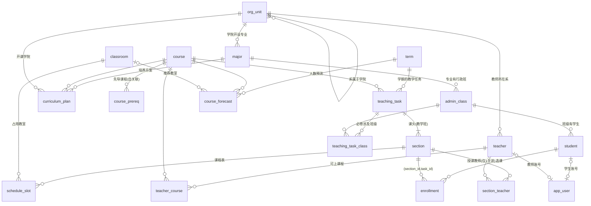

# 数据库设计（MySQL 8 / InnoDB / utf8mb4）

脚本在 [`sql/`](../sql/)：`01_schema.sql` 建表 → `02_views.sql` 视图 → `03_triggers.sql` 触发器 → `04_routines.sql` 存储过程 / 函数 → `05_reference_data.sql` 参照数据。
共 **22 张表、8 个视图、6 个触发器、3 个存储过程、1 个存储函数、28 个外键、29 个 CHECK**。

## 1. ER 图

`enrollment_log`（选课流水）、`role_permission`（角色→功能）、`setting`（系统参数）是独立表，不画外键。

## 2. 表结构概览

| 分组 | 表 | 说明 |
| --- | --- | --- |
| 基础信息 | `org_unit` | 学院 / 系（`kind` 区分，CHECK 保证「系必有上级学院、学院没有上级」） |
| | `major` `admin_class` `student` `teacher` `classroom` | 专业、行政班（专业 + 入学年份）、学生（只存所属班级）、教师、教室（教学区 / 楼 / 层 / 多媒体 / 容量） |
| 培养方案 | `course` `course_prereq` `teacher_course` `curriculum_plan` | 课程、先导课程（自关联）、教师可上课程、专业 × 学期 × 课程的计划（学时 / 学分 / 开课学院 / 必修·任选） |
| 教学安排 | `term` | 学期 = 教学进程计划：教学日历周数、开学日期、自由选课窗口 |
| | `teaching_task` `teaching_task_class` | 教学任务（由进程计划 + 培养方案生成）、必修涉及的行政班及人数 |
| | `section` `section_teacher` `schedule_slot` | 课头（教学班，含容量和已选人数）、课头教师（可多人，仅 1 主讲）、课程表（星期 / 节次 / 周次 / 教室） |
| 选课 | `enrollment` `enrollment_log` | 选课库（已选列表）、选课 / 退选流水 |
| 数据挖掘 | `course_forecast` | 任选课人数预测及推荐教室 |
| 系统 | `app_user` `role_permission` `setting` | 账号、角色权限、系统参数（教学班人数限额） |

## 3. 范式分析与有意的冗余

- **3NF**：`student` 只存 `class_id`，专业 / 入学年份 / 学院由班级推导（视图 `v_student`）——否则会出现 学号 → 班级 → 专业 的传递依赖。教师所在学院由 `dept_id` → `org_unit.parent_id` 推导。
- **多对多都拆成关联表**：先导课程、教师可上课程、课头教师、必修涉及班级。
- 为了业务正确和性能，保留了几处**有意的冗余**，都有机制保证一致：

| 冗余字段 | 原因 | 一致性保证 |
| --- | --- | --- |
| `section.enrolled_count` | 选课时要立刻判断是否满员，避免每次 `COUNT(*)` | 仅由触发器 `trg_enroll_after_insert/delete` 修改；`CHECK (enrolled_count BETWEEN 0 AND capacity)`；测试与 `06_report_queries.sql` 7c 校验 |
| `enrollment.task_id` | 让主键 `(student_id, task_id)` 直接表达「同一学期同一课程只能选一个教学班」 | 复合外键 `(section_id, task_id) → section(id, task_id)`，任务与课头不可能错配 |
| `teaching_task.hours` / `required_count` | 教学任务生成时的快照（培养方案、班级人数之后可能调整，但已发布的任务不应随之变动） | 由 `sp_generate_tasks` 统一生成，可重复执行刷新 |
| `term.id` | 字符串学期号（如 `2026-2027-2`）便于阅读和排序 | `CHECK (id = CONCAT(year_start, '-', year_start+1, '-', term_no))` |

## 4. 约束设计

| 需求 | 实现 |
| --- | --- |
| 账号全英文、不重复（不区分大小写） | `app_user.username` 主键，排序规则 `utf8mb4_0900_ai_ci`（`Admin`=`admin`）+ `CHECK (REGEXP_LIKE(username,'^[A-Za-z]{1,32}$','c'))` |
| 账号与学生 / 教师绑定 | `CHECK` 保证学生账号只填 `student_id`、教师账号只填 `teacher_id`、管理类账号都为空；两列各有唯一索引（一人一号） |
| 每个课头只有一个主讲，但可多人合上 | `section_teacher.lead_key` 虚拟生成列（主讲时为 `section_id`，否则 `NULL`）+ 唯一索引 `ux_section_one_lead`（唯一索引允许多个 `NULL`） |
| 同一学期同一课程只选一个教学班 | `enrollment` 主键 `(student_id, task_id)` |
| 一门课在一个专业培养方案里只出现一次 | `uk_plan_major_course (major_id, course_id)` |
| 学期、课程号、教室等不重复 | `uk_term_year_no`、`uk_task_term_course`、`uk_room (building, room_no)`、`uk_section_no (task_id, section_no)` |
| 取值范围 | 全部用 `CHECK`：学时 / 学分 / 容量 > 0，学期序号 1~8，节次 1~12，周次 `week_start ≤ week_end`，星期 1~7，选课窗口起 ≤ 止…… |
| 枚举值 | `ENUM`：课程性质（必修 / 任选）、角色、学院 / 系 |
| 引用完整性 | 28 个外键；教学任务 → 课头 → 教师 / 课程表 / 选课记录逐级 `ON DELETE CASCADE`（删学期即删其教学任务），基础信息被引用时禁止删除 |

## 5. 索引设计

索引围绕「冲突检测」和「选课」两条热路径设计：

| 索引 | 服务的查询 |
| --- | --- |
| `schedule_slot (classroom_id, weekday)` | 触发器 `trg_slot_room_conflict` 判断某教室某天是否被占用 |
| `enrollment (section_id, task_id)` | 课头选课名单、`enrolled_count` 对账、复合外键 |
| `enrollment` 主键 `(student_id, task_id)` | 「该学生本学期是否已选此课」、学生已选课程列表（前缀 `student_id`） |
| `teaching_task uk (term_id, course_id)` | `sp_generate_tasks` 的 `ON DUPLICATE KEY UPDATE`；按学期列任务 |
| `curriculum_plan (major_id, semester_no)` | 视图 `v_class_term_plan` 按专业 + 学期推导班级应修课程 |
| `admin_class (major_id, enroll_year)` | 同上，按专业和年级找班级 |
| `enrollment_log (student_id, acted_at)` | 查某学生的选课 / 退选历史 |
| `classroom (capacity)` | 按容量推荐最小可用教室 |

## 6. 视图

| 视图 | 作用 |
| --- | --- |
| `v_class` / `v_student` | 班级（带专业、学院）/ 学生（带班级、专业、入学年份、学院）——3NF 拆开后的“宽表” |
| `v_class_term_plan` | 学期 × 班级 → 应修课程：`(学期年份 − 入学年份) × 2 + 学期序号 = 培养方案学期序号`，教学进程和任务生成都基于它 |
| `v_section` | 课头 + 课程 + 教师（`GROUP_CONCAT`，主讲在前）+ 容量 / 已选 |
| `v_slot` | 课程表条目 + 教室 + 课头信息，课表网格和打印用 |
| `v_course_term_enroll` | 课程 × 学期的选课人数，数据挖掘的历史数据来源 |
| `v_class_term_stat` / `v_teacher_term_stat` | 选课总况统计（班级 / 教师维度），再用窗口函数 `LAG()` 求环比同比 |

## 7. 触发器

| 触发器 | 时机 / 表 | 规则 |
| --- | --- | --- |
| `trg_prereq_acyclic` | BEFORE INSERT `course_prereq` | 不能以自己为先导；用**递归 CTE**沿「先导的先导」向上找，发现当前课程即报「循环依赖」 |
| `trg_section_teacher_qualified` | BEFORE INSERT `section_teacher` | 教师必须在 `teacher_course` 里有该课程的任课资格 |
| `trg_slot_room_conflict` | BEFORE INSERT `schedule_slot` | 结束周不得超过学期教学日历周数；同学期内同教室、同星期、节次区间重叠且周次区间重叠 → 教室冲突 |
| `trg_enroll_capacity` | BEFORE INSERT `enrollment` | `SELECT … FOR UPDATE` 锁住课头行后核对 `enrolled_count < capacity`；即使有人绕过存储过程直接 INSERT 也超不了员 |
| `trg_enroll_after_insert` / `trg_enroll_after_delete` | AFTER INSERT / DELETE `enrollment` | `enrolled_count` ±1，写 `enrollment_log`（选课 / 退选） |

触发器用 `SIGNAL SQLSTATE '45000'` 抛出中文提示（错误号 1644），应用层原样展示。

## 8. 存储过程与函数

| 例程 | 作用 |
| --- | --- |
| `sp_generate_tasks(term, OUT created, OUT updated)` | 教学进程 → 教学任务：对 `v_class_term_plan` 按课程聚合，一条 `INSERT … SELECT … ON DUPLICATE KEY UPDATE` 生成 / 刷新任务（必修人数 = 各班人数之和；任何一个专业列为必修即视为必修），再重建 `teaching_task_class`。整个过程一个事务，**幂等** |
| `sp_enroll(student, section, now, OUT code, OUT msg)` | 选课。顺序：课头存在 → 选课时段 → 必修须是本班课程 → `START TRANSACTION` → 锁课头行 → 是否已选 → 与已选课程上课时间冲突 → 是否满员 → `INSERT enrollment` → `COMMIT`。返回码：0 成功 / 1 不存在 / 2 不在时段 / 3 非本班必修 / 4 已选 / 5 时间冲突 / 6 已满 / 9 其他数据库错误（异常处理器回滚） |
| `sp_drop(student, task, now, OUT code, OUT msg)` | 退选，仅限自由选课时段内 |
| `fn_forecast_enroll(course, term)` | 数据挖掘：取同学期序号历年人数，用 `COUNT/SUM` 求最小二乘一元线性回归并外推，四舍五入取整；无历史数据返回 `NULL`。应用层的 Python 实现与它做交叉校验（`tests/test_analytics.py`） |

> `sp_enroll` / `sp_drop` 内部自己管理事务（会隐式提交），所以**不要**在外层事务里调用它们。

## 9. 事务与并发控制

选课是典型的「读—判断—写」，朴素做法（先 `SELECT COUNT(*)` 再 `INSERT`）在并发下会超卖。本项目的做法：

1. `sp_enroll` 在事务内先 `SELECT capacity, enrolled_count FROM section WHERE id = ? FOR UPDATE`，对**该课头一行**加排他锁（InnoDB 行级锁）。同一课头的并发选课在这里排队，后到者读到的一定是前者提交后的最新 `enrolled_count`；不同课头互不影响。
2. 锁住之后才做「是否已选 / 时间冲突 / 是否满员」判断，判断与写入在同一事务内，没有间隙。
3. 触发器 `trg_enroll_capacity` 再次加锁校验，`CHECK (enrolled_count BETWEEN 0 AND capacity)` 是最后一道防线——三层保证，任何一层单独都能阻止超员。
4. 只锁 `section` 一行、且每个事务只锁一行，不存在加锁顺序颠倒，不会死锁；异常时由处理器 `ROLLBACK` 并返回 9。
5. 同一学生并发重复提交同一门课：主键 `(student_id, task_id)` 保证只会成功一次。

`tests/test_selection.py` 用多线程（每线程独立连接，线程栅栏对齐后同时发起）验证：30 人抢 5 个名额恰好 5 人成功、20 人抢最后 1 个名额恰好 1 人成功、同一学生 8 个并发请求只成功 1 次；并校验 `enrolled_count` = `enrollment` 行数 = 选课流水数。

## 10. 与应用层的分工

| 在 MySQL 里 | 在应用（Python）里 |
| --- | --- |
| 所有约束、唯一性、引用完整性 | 表单校验与友好提示（把 MySQL 错误号翻译成中文） |
| 选课 / 退选全流程、教学任务生成 | 课头拆分计算、教师自动分配（负载均衡） |
| 冲突触发器（教室 / 教师资格 / 先导环） | 自动排课算法（同课头保持教室、就近换教室）——复杂的启发式搜索放在应用层更易维护；写入时仍经触发器校验 |
| 统计视图 + 窗口函数、预测函数 | 图表（SVG）渲染、页面 |

## 11. 其他

- **初始化顺序**：`run.py` 的 `init_database` = 删库重建 → 依次执行 `sql/01~05` → 导入演示数据（`app/seed.py`，会走完整的业务流程：生成任务 → 预测 → 拆课头 → 分配教师 → 自动排课）。
- **脚本可重复执行**：表 / 视图 / 触发器 / 例程均先 `DROP … IF EXISTS` 再创建。
- **binlog**：MySQL 8 默认开启 binlog，创建触发器 / 存储函数需要 SUPER 或 `log_bin_trust_function_creators=1`。
